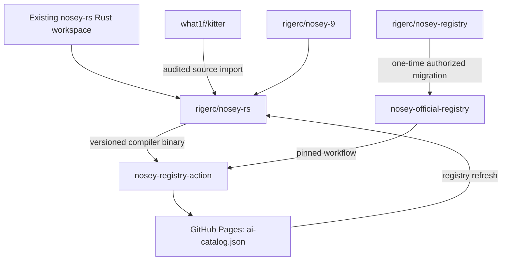

[Plan index](../nosey-implementation-plan.md) · [Previous: 1. Product scope and workflows](01-product-scope-and-workflows.md) · [Next: 3. Upstream audit and parity boundaries](03-upstream-audit-and-parity.md)

## 2. Repositories, branding and licensing

### 2.1 Repository topology

| Repository | Responsibilities | License |
|---|---|---|
| [`rigerc/nosey-rs`](https://github.com/rigerc/nosey-rs) | Existing Rust workspace; import Kitter, shared Rust domains, desktop, CLI, schemas, compiler, migration tool | MIT for new code; preserve Apache-2.0 and MIT upstream obligations |
| `nosey-official-registry` | Independently maintained registry YAML, fixtures, provenance, publishing workflow | CC BY 4.0 for data where rights permit |
| `nosey-registry-action` | Reusable GitHub Action using the versioned compiler, validation and Pages publishing integration | MIT |

The application owner and repository are confirmed: `rigerc/nosey-rs`, not `rigerc/nosey`. The product, application ID namespace and CLI remain Nosey / `nosey`. The companion repository names are retained from the interview; their owners and production endpoints have not separately been confirmed. The new official registry is a separate repository, not a renamed or continuously synchronized `rigerc/nosey-registry`. Use `rigerc/nosey-rs` as the integration host; do not create a replacement application repository or rewrite its existing history. Keep upstream references read-only. Pin exact upstream commits in `docs/upstream-baseline.yaml` and preserve attribution and source history where practical via a documented, non-destructive import. The supplied archive is not a Git checkout and cannot establish whether a GitHub fork relationship exists.

### 2.2 Rebranding checklist

- Replace existing `rs-template`, `sample-app`, and `example-crate` placeholders in product-facing metadata, README badges, documentation, package manifests and release smoke tests with the actual repository/product names. Do not globally replace template history or attribution.
- Rename imported Kitter package/binary/application identifiers, titles, desktop entry, icons, AppImage metadata, documentation and release artifacts to Nosey. Keep the repository slug `nosey-rs` distinct from the CLI binary `nosey`.
- Set workspace repository/homepage metadata to `https://github.com/rigerc/nosey-rs`; set documentation URLs to actual published endpoints only once confirmed. Retain template MIT license and NOTICE attribution alongside all Kitter and Nosey-9 obligations.
- Desktop internal executable `nosey-desktop`; user CLI `nosey`; standalone registry compiler `nosey-registry` (working executable name).
- Use Nosey's own Linux application-data namespace and configuration paths; preserve Kitter's persistence mechanism, not its data directory.
- No migration, shared state, Kitter-specific import wizard or adoption of pre-existing unmanaged skill links.
- Retain upstream copyright, license and applicable NOTICE and modification notices. Audit dependency licenses. New MIT code does not relicense Apache-derived source.

### 2.3 Registry licensing gate

A registry-level license and individual skill licenses are separate. Registry Studio requires authors to declare a registry license and record skill licensing, attribution and provenance. CC BY 4.0 applies to authorized official registry data, not automatically to upstream skills or bundled source code.

The original registry's redistribution and relicensing permission remains unresolved. Obtain a documented basis for each imported category of data before public release. Quarantine unauthorized data, do not publish it or assume Nosey-9's MIT code license covers it. Continue private development with synthetic or otherwise authorized test fixtures. Do not substitute a supplemental catalog; the original registry is the only initial data source. If the licensing gate cannot be satisfied, release of the populated official registry is blocked until the user revises the requirement.

---

[Plan index](../nosey-implementation-plan.md) · [Previous: 1. Product scope and workflows](01-product-scope-and-workflows.md) · [Next: 3. Upstream audit and parity boundaries](03-upstream-audit-and-parity.md)
