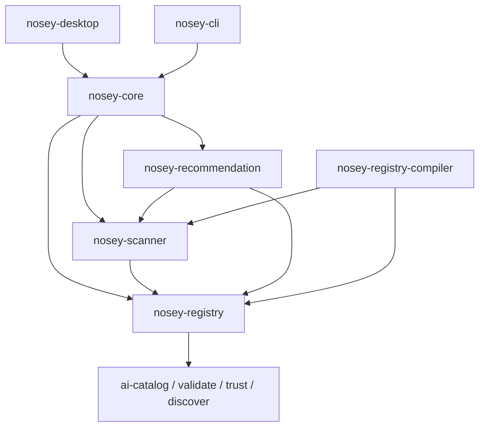

[Plan index](../nosey-implementation-plan.md) · [Previous: 3. Upstream audit and parity boundaries](03-upstream-audit-and-parity.md) · [Next: 5. Registry specification and interoperability](05-registry-specification-and-interoperability.md)

## 4. Rust workspace and architecture

### 4.1 Domain-oriented workspace

```text
nosey-rs/
├── Cargo.toml
├── Cargo.lock
├── VERSION
├── rust-toolchain.toml
├── crates/
│   ├── nosey-core/
│   ├── nosey-desktop/
│   ├── nosey-cli/
│   ├── nosey-registry/
│   ├── nosey-scanner/
│   ├── nosey-recommendation/
│   ├── nosey-registry-compiler/
│   └── xtask/                       # existing development tooling
├── schema/
│   └── nosey-registry/              # product schema source of truth
├── scripts/                         # existing automation
├── config/                          # existing tooling policies
├── tests/fixtures/
│   └── nosey/                       # new product fixture namespace
├── docs/
│   ├── nosey-implementation-plan.md # plan index
│   ├── nosey-plan/                 # numbered implementation chapters
│   ├── adr/
│   ├── upstream-baseline.yaml       # planned
│   ├── parity-matrix.md             # planned
│   ├── registry-spec/               # planned
│   └── src/                         # existing mdBook
└── .github/workflows/
```

| Crate | Responsibility |
|---|---|
| `nosey-core` | Kitter-derived library, sources, projects, agent plugins, instructions, settings, presets, effective skills, token estimates, ownership, pending changes, operations, updates and persistence; orchestration services |
| `nosey-desktop` | GPUI views, UI state, notifications, wizard, Studio, user interactions |
| `nosey-cli` | Essential CLI commands and existing compatible Kitter CLI capabilities |
| `nosey-registry` | AI Catalog SDK adapter and Nosey policy, extension models, YAML authoring and compiler library, catalog index, caching, trust, registry CRUD, Git authoring/source import support |
| `nosey-scanner` | Generic traversal, Nosey-9-compatible parsing and rules, structured evidence and fixture execution |
| `nosey-recommendation` | Pure mapping/combination evaluation, recommendation ordering and deduplication, dismissal/status presentation logic |
| `nosey-registry-compiler` | Lightweight headless executable calling registry validation/compiler and scanner fixture code |
| `xtask` (existing tooling, not a product domain) | Quality gates, template/tooling commands and repository automation; optionally host a private one-time migration command using shared registry types |



The seven confirmed product crates coexist with the existing `xtask` tooling crate; the one-time migration does not need a ninth permanent package. Treat the registry, scanner and recommendation crates as lower domain layers and `nosey-core` as an orchestration layer. Document this concrete DAG in `docs/architecture.md` and update applicable dependency-policy rules in `deny.toml`; suffix-based descriptions alone do not enforce it. Registry types do not depend on scanner or core. Scanner returns typed observations; recommendation uses observations and immutable catalog inputs. To avoid cycles, pass observations via scanner types and inject installed-skill facts as inputs rather than allowing recommendation to query core. The compiler orchestrates scanner fixtures outside the registry library. GPUI is isolated from headless crates. Desktop and CLI call the same core services, never reimplement policy.

### 4.2 Dependency strategy

Prefer existing Kitter dependencies, `serde` and its existing storage codecs. Evaluate maintained YAML parsing, `serde_json`, the existing CLI parser, glob/regex crates, ignore-aware traversal, and HTTP/native Git libraries only as needed. Choose a Git transport that actually supports the user's SSH agent, known_hosts and credential helpers; a system Git invocation is an acceptable implementation choice if required for faithful credential reuse, but do not silently add a mandatory GitHub CLI. Avoid a database, server, JavaScript runtime, Go sidecar or separate search service. Rust registry validation must be identical in Studio and the compiler. Use existing GPUI task/executor primitives; blocking I/O must run off the UI thread.

### 4.3 AI Catalog SDK dependency boundary

Use the Apache-2.0 [Agent-Card/ai-catalog-rust](https://github.com/Agent-Card/ai-catalog-rust/tree/920ef70e1e5a602e142137f9ea6a1135fedbf110) workspace, reviewed at commit `920ef70e1e5a602e142137f9ea6a1135fedbf110`. Its root manifest declares version 0.4.0, Rust 1.95 and edition 2024; the README usage example still shows 0.2. Pin all four crates to the same reviewed Git revision initially, with workspace-managed dependencies and a committed lockfile (confirm source allowlisting in `deny.toml`); an equivalent published release may replace the Git pin only after checking API/spec equivalence and fixtures. This is a planned manifest change, not an applied dependency update.

```toml
[workspace.dependencies]
ai-catalog = { git = "https://github.com/Agent-Card/ai-catalog-rust", rev = "920ef70e1e5a602e142137f9ea6a1135fedbf110" }
ai-catalog-validate = { git = "https://github.com/Agent-Card/ai-catalog-rust", rev = "920ef70e1e5a602e142137f9ea6a1135fedbf110" }
ai-catalog-trust = { git = "https://github.com/Agent-Card/ai-catalog-rust", rev = "920ef70e1e5a602e142137f9ea6a1135fedbf110" }
ai-catalog-discover = { git = "https://github.com/Agent-Card/ai-catalog-rust", rev = "920ef70e1e5a602e142137f9ea6a1135fedbf110" }
```

| Dependency | Responsibility in `nosey-registry` |
|---|---|
| `ai-catalog` | Standard models, media constants, parse/serialize |
| `ai-catalog-validate` | Semantic diagnostics, structural conformance, publisher/operator verification |
| `ai-catalog-trust` | Strict JSON, JCS, digest checking, ES256 verification |
| `ai-catalog-discover` | Standard discovery via Nosey's safe fetch adapter |

No parallel base wire model, duplicate validator, homegrown JCS/ES256 verification or external AI Catalog CLI dependency. No `ai-catalog-oci` in v1.0: OCI distribution is out of scope. Keep SDK imports at the registry boundary, translating to Nosey domain views, typed errors and extension structs; compiler, Studio, scanner and core consume the same registry services. If an SDK gap exists, document it and contribute a narrowly scoped upstream fix or adapter; do not silently fork the specification. Signing production is separate from verification; use reviewed signing primitives where necessary.

### 4.4 Repository integration sequence and coding contract

1. Work in the existing `rigerc/nosey-rs` Git checkout when implementation begins. Record its current commit, branch, status, remotes and baseline test results. Use separate pinned upstream reference checkouts; do not overwrite the template with Kitter or run the template initializer blindly against an existing working tree. The ZIP is suitable for inspection, not for preserving Git history itself.
2. Import Kitter's actual source, resources and tests in reviewable batches into `nosey-core`, `nosey-desktop` and `nosey-cli`. Keep upstream source paths/commit hashes, licensing and deliberate behavioral changes in the parity matrix. Do not copy upstream `.git`, CI, Cargo workspace root or user data over the destination. A non-squashed subtree or annotated import can preserve source provenance; choose after reviewing history and layout, without rewriting the host branch.
3. Extract registry, scanner, recommendation and compiler crates, moving real code only after its baseline tests are understood. Register all seven product crates and `xtask` in the root manifest. Retire placeholder members only once the replacement is runnable and references in examples, CI, docs and release scripts have been updated. Keep GPUI out of the headless compiler dependency graph.
4. Reconcile workspace edition, MSRV, toolchain, upstream GPUI pins, Linux system libraries, `Cargo.lock`, feature flags and dependency source/license policy. Retain workspace-managed dependency versions; isolate any justified upstream Git dependency to a reviewed source/pin. Do not loosen workspace safety or supply-chain policy as a shortcut.
5. Respect `AGENTS.md`: forbid unsafe code in project crates; typed library errors (`thiserror`), contextual binary errors (`anyhow`); no library `unwrap()`/`expect()`; bounded input and concurrency; blocking work off async/UI executors; public-item documentation; source files within the 500-LOC rule; no blanket lint suppressions. Strict own-config validation must not reject standard AI Catalog unknown extensions that are explicitly allowed by the specification. Follow conventional commits and the repository test-first workflow.
6. Use `bd prime` / `bd ready` / `bd show` and Beads for durable implementation work. Convert section 19 work items into Beads epics/issues with dependencies, rather than treating this plan as a live TODO list. Record work status through Beads and avoid duplicate tracking in `plans/` or `.agents/` logs. Do not commit, push or sync Beads remotely without appropriate authorization.
7. Reuse `./scripts/bootstrap.sh`, `./scripts/doctor.sh`, `./scripts/quality-gates.sh`, `cargo xtask` commands where supported by the existing aliases, and optional `scripts/setup-gpui-mcp.sh`. Update existing docs and agent context only for real product changes. Validate the repo-native quality pipeline as well as the product test scope in section 18.

---

[Plan index](../nosey-implementation-plan.md) · [Previous: 3. Upstream audit and parity boundaries](03-upstream-audit-and-parity.md) · [Next: 5. Registry specification and interoperability](05-registry-specification-and-interoperability.md)
