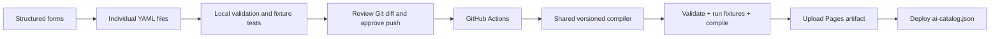

[Plan index](../nosey-implementation-plan.md) · [Previous: 13. Desktop and onboarding](13-desktop-and-onboarding.md) · [Next: 15. CLI and standalone compiler](15-cli-and-standalone-compiler.md)

## 14. Registry Studio and publishing

### 14.1 Authoring workspaces

Open an existing local Git working tree or clone an existing GitHub registry into a user-selected directory. Create a new registry locally from the full publishing template, associate it with a GitHub remote, and push explicitly approved changes. Users retain ownership of authoring paths. Do not clone all consumption registries or compile remote YAML to consume catalogs.

Git working tree is the draft workspace. Save entity form edits directly to individual YAML files, use Git status/diff for unpublished changes, review or discard specific modifications, validate, commit and push. Handle uncommitted external changes, merge conflicts and non-fast-forward pushes without silently overwriting work. Do not add a separate draft persistence system. Do not force-push by default. Repository initialization generates manifest, entity dirs, fixtures, schemas, README, license, `.gitignore` and publishing workflow; Git does not preserve empty directories without placeholders, so use a documented convention.

### 14.2 Structured editing

Entity-specific forms with required fields, selectors for technology and canonical artifact references, supported rule/operator inputs based on audited grammar, inline field/schema validation, and cross-reference warnings. Provide create/edit/remove for technologies, rules, mappings, combinations, skill metadata, source repositories, assessments, provenance and registry metadata. Official taxonomy authority restrictions apply to custom authoring as well. No embedded YAML source editor, general skill content editor or external editor integration feature.

Authors can validate draft data and compile a preview through the same Rust registry library used by the standalone compiler. Test draft detection rules against a selected registered local project using the shared scanner, respecting privacy and safety limits. Do not modify saved project scan state or generate pending installation changes from draft tests. Reusable fixtures define project tree/manifests and expected detections, executed locally and in CI. Connectivity policy for ordinary scans remains online-only; fixture execution is a build/test operation and must not depend on the production catalog endpoint.

### 14.3 Tracked source imports

- Add a Git source repository, discover valid `SKILL.md` files under permitted directories and display candidates.
- Support individual, multi-select and bulk import; review metadata, source paths, license and canonical identity before creating records.
- Initial import extracts supported frontmatter; all curated metadata becomes registry-owned.
- Periodically check tracked repositories while desktop is open; present newly added, modified and removed upstream skills.
- After approval, synchronize only existing skill source revisions and availability, not manually edited descriptions, tags, technology associations, dependency/conflict declarations or assessments.
- Mark unavailable entries, offer optional authoring cleanup, preserve installed local skills. Actual upstream skill content remains maintained externally.

### 14.4 GitHub authentication and creation constraints

Reuse existing Git credentials, SSH keys, credential helpers and host verification. No new OAuth flow, token-management UI or mandatory `gh` CLI. Existing SSH credentials can authorize clone/push but cannot generally authorize GitHub API repository creation or Pages settings. Use API-compatible existing credentials only if legitimately available for that operation; otherwise guide the author to create the remote repository/enable Pages in GitHub and return to Studio. This limitation follows from the chosen authentication method; do not advertise guaranteed in-app API creation for SSH-only users. No credentials in registry files or settings exports.

### 14.5 Publication pipeline



The separate `nosey-registry-action` repository packages a reusable Action which downloads a pinned version of the Linux x86-64 compiler from Nosey release artifacts, verifies expected integrity, validates source YAML, runs detection fixtures and compiles a single AI Catalog JSON document. The consuming workflow configures GitHub Pages and grants only necessary permissions to the deployment job. Because Pages deployments require job-level permissions/environment, the reusable Action may handle build/upload while the generated workflow runs the standard deployment step; final integration must match GitHub's supported Action/workflow semantics. No second compiler implementation. Studio and the released compiler use the same pinned AI Catalog SDK and Nosey validation adapter. Display SDK diagnostic code/path/severity alongside YAML/entity diagnostics; verify output using the SDK on the exact served bytes. The Action invokes the released compiler rather than maintaining a separate AI Catalog implementation or requiring the external AI Catalog CLI. Signing, if configured, uses a reviewed signer plus SDK canonicalization and verification, with secrets available only to the authorized publishing job.

A representative workflow skeleton (placeholders, not executable production workflow; pin actual action revisions and compiler hashes after creating repos):

```yaml
name: Publish registry
on:
  push:
    branches: [main]
  workflow_dispatch:
permissions:
  contents: read
concurrency:
  group: registry-pages
  cancel-in-progress: false
jobs:
  build:
    runs-on: ubuntu-latest
    steps:
      - uses: actions/checkout@<pinned-revision>
      - uses: <owner>/nosey-registry-action@<pinned-revision>
        with:
          compiler-version: '1.0.0'
          registry-directory: .
          output-directory: dist
      - uses: actions/upload-pages-artifact@<pinned-revision>
        with:
          path: dist
  deploy:
    needs: build
    runs-on: ubuntu-latest
    permissions:
      pages: write
      id-token: write
    environment:
      name: github-pages
      url: ${{ steps.deployment.outputs.page_url }}
    steps:
      - name: Deploy catalog
        id: deployment
        uses: actions/deploy-pages@<pinned-revision>
```

Resolve the exact action input contract and current Pages prerequisites during implementation. Successful deployment publishes stable `https://<owner>.github.io/<repo>/ai-catalog.json`. Failed validation/tests/compilation must not trigger deployment or replace last successful catalog. Surface publishing status where supported by available credentials/public status APIs; otherwise link to GitHub Actions and verify the published endpoint. No guarantee that Pages provides private registry distribution: private/credentialed hosting details require separate confirmation and should not be inferred from private Git access.

---

[Plan index](../nosey-implementation-plan.md) · [Previous: 13. Desktop and onboarding](13-desktop-and-onboarding.md) · [Next: 15. CLI and standalone compiler](15-cli-and-standalone-compiler.md)
