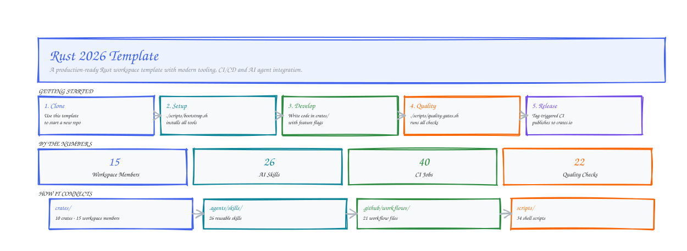

# Architecture

## Overview Diagram

A human-friendly overview of the project — what it is, how to get started, and what's inside.

## What the Diagram Shows

- **Getting Started** — Clone, setup, develop, quality, release workflow
- **What's Inside** — Workspace crates, AI skills, pipeline stages, quality checks
- **How It Connects** — Ecosystem directories and their relationships

## Workspace Members

| Kind | Crate | Purpose |
|------|-------|---------|
| Application | `sample-app` | Reference binary (default member) demonstrating config, errors and tests |
| Library | `example-crate` | Minimal library crate to copy from |
| Tooling | `xtask` | `cargo xtask` automation: quality gate, template init, telemetry |
| Example | `hello_world` | Smallest binary using `example-crate` |
| | `cli_dry_run` | Safe `--dry-run` pattern for costly side effects |
| | `security_egress_and_path_validation` | SSRF-safe egress policy and untrusted path validation |
| | `security_secret_detector` | Secret detection with masked reporting |

Members are discovered by the `crates/*` and `examples/*` globs in the root `Cargo.toml`.

## Overview Diagram Source

`docs/src/overview.svg` is a static asset. The generator that produced it (the upstream
`architecture-diagram` skill) does not ship with this repository, so edit or replace the SVG
directly when the project's shape changes.
